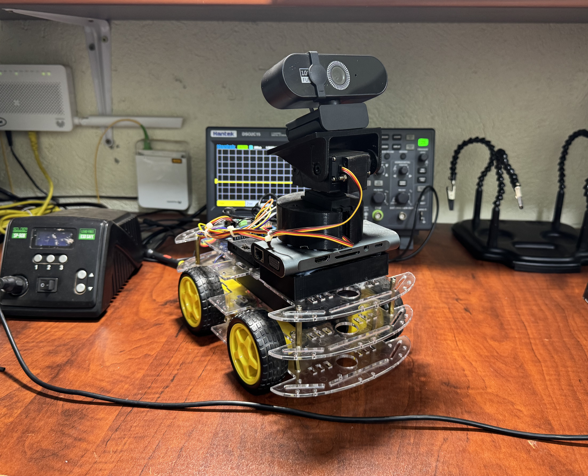

# Office Assistant Face Tracker

An Arduino UNO Q vision project that recognizes enrolled people and follows them with a two-axis PCA9685 pan/tilt camera. The long-term goal is a voice-enabled 4WD office assistant that can respond when called, locate the caller, and drive toward them.



> **Current status:** face enrollment, local face recognition, pan/tilt tracking, and lost-face scanning are implemented. The L298N chassis is wired and documented, but autonomous wheel movement and speech recognition are planned work and are not yet enabled by this code.

## What works today

- Enrolls 8–12 camera views for each person from a browser interface
- Stores names, photos, and normalized face embeddings locally in SQLite
- Recognizes enrolled people with the OpenCV SFace ONNX model
- Moves the pan/tilt camera only after a confident identity match
- Smoothly follows the recognized face using two PCA9685 servo channels
- Searches across three tilt levels when the tracked face is lost
- Reacquires only the previously recognized identity
- Runs recognition locally on the UNO Q; face images are not sent to a cloud service

## System overview

```text
USB webcam
    │
    ▼
UNO Q Linux side ── face detection, SFace recognition, SQLite, web UI
    │ Router Bridge
    ▼
UNO Q MCU side
    ├── I²C ── PCA9685 ── pan servo + tilt servo      [implemented]
    └── pins 2–7 ── L298N ── left + right wheel sets [planned in software]
```

## Hardware

- Arduino UNO Q
- PCA9685/HW-170 16-channel servo driver
- Two compatible hobby servos and a pan/tilt camera bracket
- UVC USB webcam
- Powered USB-C hub and 5 V/3 A supply
- L298N dual H-bridge motor driver
- 4WD robot chassis with four DC geared motors
- A separate, suitable motor battery/power supply
- Jumper wires and a shared common ground

## Wiring

### PCA9685 and pan/tilt servos

| UNO Q / supply | PCA9685 | Purpose |
|---|---|---|
| 3.3 V | VCC | Logic power |
| GND | GND | Common ground |
| SDA | SDA | I²C data |
| SCL | SCL | I²C clock |
| External regulated 5–6 V | V+ | Servo power |

- Pan/base servo: PCA9685 channel `0`
- Tilt/upper servo: PCA9685 channel `1`
- PCA9685 address: `0x40`
- Servo frequency: `50 Hz`

Do not power the servos from the UNO Q logic rail. Connect the external servo-supply ground to the UNO Q ground.

### L298N and 4WD chassis

| UNO Q pin | L298N pin | Intended function |
|---|---|---|
| D2 | IN1 | Left-side direction A |
| D3 | IN2 | Left-side direction B |
| D4 | IN3 | Right-side direction A |
| D7 | IN4 | Right-side direction B |
| D5 (PWM) | ENA | Left-side speed |
| D6 (PWM) | ENB | Right-side speed |
| GND | GND | Common control ground |

Connect the two left motors as one L298N channel and the two right motors as the other, subject to the driver's current rating. Remove the ENA/ENB jumpers when using PWM speed control. Power the motors from a supply appropriate for the motors—not from the UNO Q—and join the motor-driver ground to the UNO Q ground.

> Verify the current drawn by two motors on each channel, including stall current. The common L298N module is inefficient and can run hot; use a better-rated driver if the chassis exceeds its safe current or thermal limits. Test with the wheels raised before enabling drive code.

## Software setup

1. Clone or download this repository.
2. Connect the PCA9685, servos, webcam, and external supplies using the tables above.
3. Open the repository folder as an App in Arduino App Lab.
4. Select the Arduino UNO Q and run the app in **Network Mode**. App Lab deploys `python/main.py` to Linux and flashes `sketch/sketch.ino` to the MCU.
5. Open the generated web interface, normally `http://<board-name>.local:7000`.
6. Enter a name under **Enroll a person**, choose the number of samples, and start enrollment.
7. Keep one face visible and slowly look forward, left, right, up, and down.
8. After enrollment, the pan/tilt camera follows that person when recognition is confident.

The Python dependency is declared in `python/requirements.txt`. Arduino App Lab supplies the Arduino-specific Python packages and application bricks.

## Calibration

Servo limits are deliberately conservative and must match the physical bracket:

| Axis | Minimum | Maximum | Direction setting |
|---|---:|---:|---|
| Pan | 110 | 500 | `PAN_DIRECTION` |
| Tilt | 110 | 200 | `TILT_DIRECTION` |

The MCU limits movement to safe pulse ranges and slews toward each target every 20 ms. If an axis moves away from the face, change its direction sign in `python/face_tracker.py`. Adjust limits in both `sketch/sketch.ino` and `python/face_tracker.py` only after testing the mechanism carefully.

The recognition threshold is `MATCH_THRESHOLD` in `python/main.py` (currently `0.46`). Increase it if unknown people are accepted; decrease it cautiously if enrolled people are rejected. Test with images that were not used for enrollment.

## Repository layout

```text
.
├── app.yaml                         Arduino App Lab definition
├── assets/                          browser UI, styles, scripts, and media
├── images/                          project photographs
├── sketch/
│   ├── sketch.ino                   PCA9685 and Router Bridge firmware
│   └── sketch.yaml                  UNO Q build profile
└── python/
    ├── main.py                      application orchestration and events
    ├── face_tracker.py              pan/tilt and search target generation
    ├── recognition.py               SFace preprocessing and embeddings
    ├── database.py                  SQLite enrollment repository
    ├── requirements.txt             Python dependency declaration
    └── face_recognition_sface_2021dec.onnx
```

The face database is created on the board at `/app/data/face-recognition.db` and should not be committed.

## Roadmap

- [x] Browser-based face enrollment
- [x] Local known/unknown face recognition
- [x] Recognized-face pan/tilt tracking
- [x] Lost-face scan and identity reacquisition
- [ ] L298N differential-drive firmware with acceleration and stop controls
- [ ] Safe approach behavior using distance/obstacle sensors
- [ ] Wake-word and speech recognition
- [ ] Voice responses and office-assistant actions
- [ ] Battery monitoring and emergency stop

Face position alone is not sufficient for safe autonomous driving. Add distance sensing, obstacle detection, loss-of-target stopping, a physical emergency stop, and controlled acceleration before allowing the robot to move on the floor.

## Privacy and responsible use

This project processes biometric data. Enroll people only with their informed consent, restrict access to the UNO Q and its web interface, and delete stored profiles when they are no longer needed. Do not use this prototype as the only control for access, security, surveillance, or another safety-critical decision.

## License

Source files carrying an `SPDX-License-Identifier` remain under the stated license. Project source is provided under the Mozilla Public License 2.0; see [LICENSE](LICENSE).

Contributions are welcome—see [CONTRIBUTING.md](CONTRIBUTING.md).
